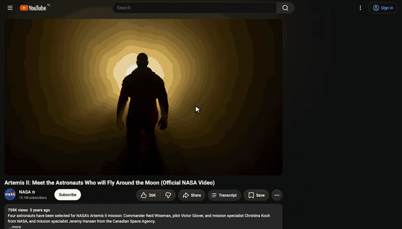

<div align="center">


# Instant Transcript

### Get the transcript of any YouTube video in one click.

Copy it, download it, or read along while the video plays.<br>
A free, open source Chrome extension. No account, no API key, no servers.

[](#install)
[](LICENSE)
[](#development)
[](#development)

[**Install**](#install) · [Features](#features) · [How it works](#how-it-works) · [FAQ](#faq) · [Privacy](#privacy)



<sub>Recorded on a NASA video (public domain).</sub>

</div>

## Why Instant Transcript?

YouTube hides its transcript behind the description's "...more" link, gives you no way to copy all of it, and lately fails to load it at all when you are signed out. Transcript websites make you copy the link, leave YouTube and wade through ads.

Instant Transcript puts a **Transcript** button right next to Like and Share. One click, and the whole transcript is there.

| | YouTube's own transcript | Transcript websites | **Instant Transcript** |
|---|:---:|:---:|:---:|
| Opens from the video page | 2 clicks, hidden in the description | Copy link, open site, paste | **1 click** |
| Copy the whole transcript | No | Yes | **Yes** |
| Download as a text file | No | Sometimes | **Yes** |
| Follows the video as it plays | Yes | No | **Yes** |
| Click a line to jump there | Yes | No | **Yes** |
| Works while signed out | Not reliably | Yes | **Yes** |
| Ads, sign-ups, tracking | No | Often | **Never** |

## Features

- **One click, instant.** The transcript appears about 200 ms after you click. Opening it again on the same video is immediate.
- **Reads along with you.** The line being spoken is highlighted and the panel scrolls with the video. Click any line to jump to that moment.
- **Copy everything.** One click copies the whole transcript, either with timestamps (`0:04 line`) or as clean paragraphs, ready for notes, documents or an AI chat.
- **Download as .txt.** Saves a text file named after the video, with the title and link at the top.
- **The right language, automatically.** Picks the language that is actually spoken: a human-written track when there is one, otherwise YouTube's auto-generated captions.
- **Feels like part of YouTube.** Same button style, light and dark themes, and the panel opens where YouTube's own panels do. In narrow windows and theater mode it moves under the video.
- **Remembers your choice.** Timestamps on or off stays the way you left it.
- **Tiny and private.** Plain JavaScript, no dependencies, no build step, no data sent anywhere except YouTube.

## Install

1. **Download** the [latest release](https://github.com/lucernyx/instant-transcript/releases/latest) and unzip it, or clone the repository:
   ```bash
   git clone https://github.com/lucernyx/instant-transcript.git
   ```
2. Open `chrome://extensions` in Chrome.
3. Turn on **Developer mode** in the top right corner.
4. Click **Load unpacked** and select the `instant-transcript` folder.
5. Open any YouTube video. The **Transcript** button sits next to Share.

**Updating:** download or pull the new version, then press the reload icon on the extension's card in `chrome://extensions`.

## How to use

| Do this | To |
|---|---|
| Click **Transcript** under the video | Open or close the transcript panel |
| Click any line | Jump the video to that moment |
| Toggle **Timestamps** | Show or hide times, in the panel and in what you copy |
| Click **Copy** | Copy the whole transcript to your clipboard |
| Click **Download** | Save it as `Video title.txt` |

## How it works

YouTube's web player now signs every caption request with a proof of origin token (`pot`). Without it, caption files come back empty, which is why most simple transcript scrapers stopped working. YouTube's own transcript endpoint (`get_transcript`) currently answers `400 FAILED_PRECONDITION` for signed-out sessions too.

YouTube's mobile apps receive caption links that do not need that token. Instant Transcript asks for captions the way the Android app does:

```text
 Transcript button
        │
        ▼
 POST /youtubei/v1/player        as the Android app client, with the video ID
        │                        → the list of every caption track
        ▼
 pick the track                  spoken language: human-written first, then auto-generated
        │
        ▼
 GET  /api/timedtext?fmt=json3   → timed lines, rendered in the panel (~0.2 s in total)
```

If YouTube turns the Android client away, the extension retries as the iOS app and then as Android VR. Both requests go straight to `www.youtube.com` from your own browser with cookies left out, so your Google account is never involved.

Transcript websites run this same technique on their servers, where thousands of requests from one address get them blocked. Running it in your own browser avoids that entirely.

## FAQ

<details>
<summary><b>How do I get the transcript of a YouTube video?</b></summary>
<br>
Install the extension, open the video and click <b>Transcript</b> next to the Share button. The full transcript opens in the right column with timestamps.
</details>

<details>
<summary><b>How do I copy a YouTube transcript?</b></summary>
<br>
Open the transcript and click <b>Copy</b>. With <b>Timestamps</b> on you get one timed line per row; with it off you get clean paragraphs that are easy to paste into notes, documents or an AI chat.
</details>

<details>
<summary><b>Can I download YouTube subtitles as a text file?</b></summary>
<br>
Yes. Click <b>Download</b> and you get a <code>.txt</code> file named after the video, with the title and link at the top.
</details>

<details>
<summary><b>Does it work with auto-generated captions?</b></summary>
<br>
Yes. When a video has no human-written captions in the spoken language, it uses YouTube's auto-generated ones. Videos with no captions at all show "This video has no transcript."
</details>

<details>
<summary><b>Which languages does it support?</b></summary>
<br>
Any language YouTube has captions for. It automatically picks the language spoken in the video.
</details>

<details>
<summary><b>Is it free? Do I need an API key?</b></summary>
<br>
It is free and open source under the MIT license. There is no API key, account or sign-up.
</details>

<details>
<summary><b>Does it work in Edge, Brave or Arc?</b></summary>
<br>
It is built and tested for Chrome. Other Chromium browsers that can load unpacked extensions (Edge, Brave, Arc, Opera) should work the same way, but they are not tested yet.
</details>

<details>
<summary><b>Why is it not on the Chrome Web Store?</b></summary>
<br>
It started as a personal tool. Installing it from this repository takes under a minute and lets you read every line of code it runs.
</details>

## Privacy

- Nothing leaves your browser except the two requests to `www.youtube.com` described above.
- No analytics, no tracking, no third-party servers, no cookies sent.
- The only permission is `storage`, used to remember whether timestamps are on.

## Limitations

- Videos without any captions cannot be transcribed.
- Age-restricted and members-only videos may fail, because the request is sent signed out.
- It relies on undocumented YouTube behavior. If YouTube changes it, the panel shows "Couldn't get the transcript" with a **Try again** button, and updating the client versions at the top of `src/transcript.js` usually fixes it.
- Works on regular watch pages, not on Shorts.

## Development

```bash
npm test
```

27 unit tests run on Node's built-in test runner, with zero dependencies. They cover time formatting, copy and download text, track selection, caption parsing and the client fallback chain.

```text
manifest.json         Extension manifest (Manifest V3)
src/transcript.js     Talks to YouTube, picks the track, parses captions
src/format.js         Timestamps, copy and download text, active line search
src/content.js        The button, the panel and the YouTube page integration
styles/panel.css      Styles built on YouTube's own color tokens
_locales/             Interface text
test/                 Unit tests
```

Found a bug or have an idea? [Open an issue](https://github.com/lucernyx/instant-transcript/issues).

## License

[MIT](LICENSE) © Lucernyx

<sub>Not affiliated with YouTube or Google. YouTube is a trademark of Google LLC.</sub>
